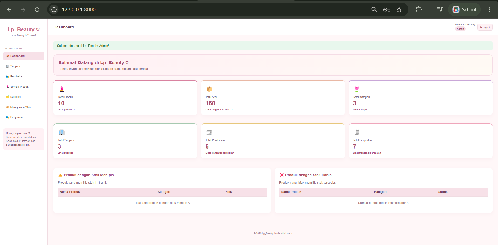
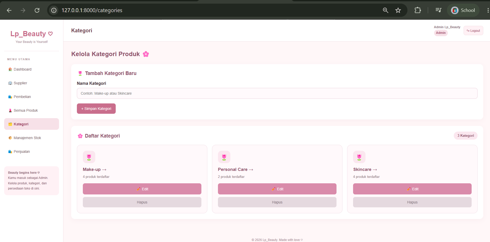
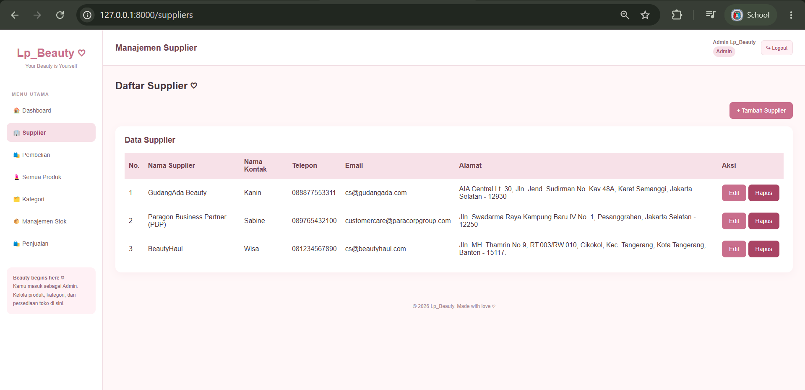
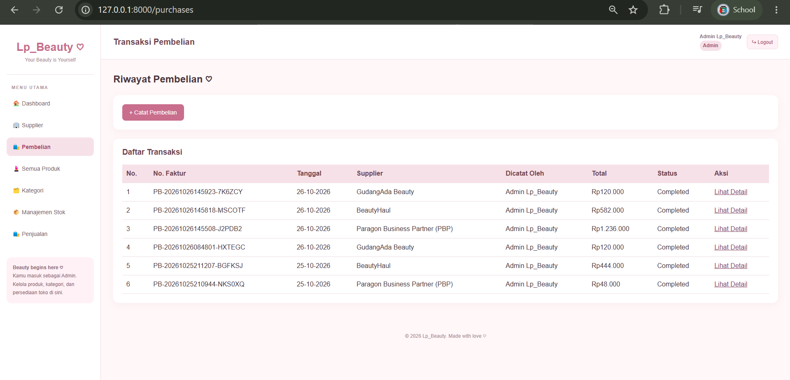
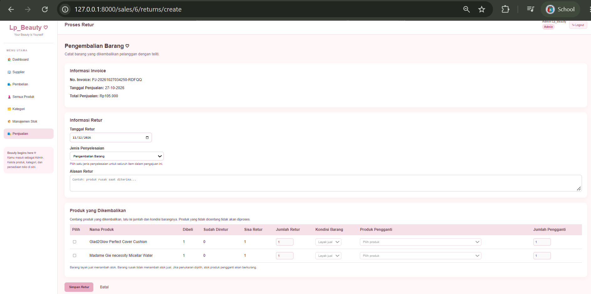

# LP Beauty – Sistem Manajemen Toko Makeup dan Skincare

LP Beauty merupakan aplikasi berbasis web yang dikembangkan menggunakan Laravel untuk membantu pengelolaan toko produk makeup dan skincare. Aplikasi ini dirancang untuk mempermudah pengelolaan produk, stok barang, pembelian, penjualan, serta pengembalian barang dalam satu sistem.

## Fitur Aplikasi

### 1. Autentikasi dan Hak Akses
- Login dan logout pengguna.
- Terdapat dua hak akses, yaitu Admin dan Staff.
- Pembatasan akses berdasarkan peran pengguna.

### 2. Dashboard
- Menampilkan ringkasan informasi toko.
- Menampilkan informasi produk, stok, dan kategori.

### 3. Manajemen Produk
- Menampilkan daftar produk.
- Menambahkan produk baru.
- Mengedit informasi produk.
- Menghapus produk.
- Mengelola SKU, nama, merek, harga, kategori, dan stok produk.
- Pencarian dan filter produk.

### 4. Manajemen Kategori
- Menampilkan kategori produk.
- Menambahkan kategori.
- Mengedit kategori.
- Mengelola kategori Makeup dan Skincare.

### 5. Manajemen Supplier
- Menampilkan daftar supplier.
- Menambahkan supplier.
- Mengelola informasi supplier.

### 6. Pembelian Barang
- Mencatat transaksi pembelian.
- Mengelola detail barang yang dibeli.
- Menambahkan stok secara otomatis setelah pembelian.

### 7. Penjualan Barang
- Mencatat transaksi penjualan.
- Mendukung penjualan dengan beberapa produk.
- Mengurangi stok secara otomatis setelah penjualan.
- Melakukan validasi agar jumlah penjualan tidak melebihi stok tersedia.

### 8. Manajemen Stok
- Mencatat perubahan stok barang.
- Menampilkan riwayat pergerakan stok.
- Mencatat penambahan dan pengurangan stok.

### 9. Pengembalian dan Penukaran Barang
- Mencatat pengembalian barang dari transaksi penjualan.
- Mendukung pengembalian barang yang masih layak jual maupun rusak.
- Mengembalikan stok untuk barang yang masih layak dijual.
- Mendukung proses penukaran barang dengan produk pengganti.

## Hak Akses Pengguna

| Fitur | Admin | Staff |
|---|---|---|
| Dashboard | Ya | Ya |
| Melihat produk | Ya | Ya |
| Mengelola produk | Ya | Tidak |
| Mengelola kategori | Ya | Tidak |
| Mengelola supplier | Ya | Tidak |
| Pembelian | Ya | Sesuai akses aplikasi |
| Penjualan | Ya | Ya |
| Melihat stok | Ya | Ya |
| Pengembalian barang | Ya | Sesuai akses aplikasi |

## Teknologi yang Digunakan

- Laravel 13
- PHP
- MySQL
- HTML
- CSS
- JavaScript
- Bootstrap
- Composer
- Laragon

## Struktur Folder

```text
lp-beauty/
├── app/
├── bootstrap/
├── config/
├── database/
├── public/
├── resources/
├── routes/
├── storage/
├── tests/
├── screenshots/
├── .env.example
├── artisan
├── composer.json
├── composer.lock
├── package.json
└── vite.config.js
```

## Dokumentasi Tampilan Aplikasi

### 1. Login dan Dashboard




### 2. Manajemen Produk


### 3. Manajemen Kategori dan Supplier






### 4. Manajemen Stok


### 5. Pembelian




### 6. Penjualan


### 7. Pengembalian Barang



## Cara Menjalankan Proyek

1. Clone repository ini atau unduh source code.
2. Pindahkan folder proyek ke direktori `www` Laragon.
3. Jalankan Apache dan MySQL melalui Laragon.
4. Buat database baru di MySQL sesuai konfigurasi proyek.
5. Buka terminal pada folder proyek.
6. Salin `.env.example` menjadi `.env`.
7. Sesuaikan konfigurasi database pada file `.env`.
8. Jalankan perintah berikut:

```bash
composer install
php artisan key:generate
php artisan migrate
npm install
npm run build
php artisan serve
```

9. Jika database menggunakan data awal, jalankan seeder sesuai konfigurasi proyek.
10. Buka aplikasi melalui browser menggunakan alamat yang ditampilkan oleh Laravel.

## Status Proyek

LP Beauty merupakan proyek pembelajaran dan pengembangan aplikasi manajemen toko berbasis Laravel yang mencakup pengelolaan produk, persediaan, pembelian, penjualan, dan pengembalian barang.